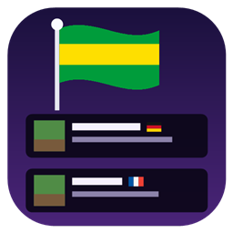

<p align="center"></p>

# Server Flags (Horizon native mod)

A small flag beside each server in your Multiplayer list for the country it is hosted in. Hover the flag for the
country's name. Pick servers close to you for a better ping at a glance.

Client side only.

## What it does

- A 12 x 8 pixel-art flag after each saved server's name (or on its icon when the name is long).
- 67 countries have a drawn flag, the ones servers are most often hosted in; any other country shows its
  two-letter code, like **MT**.
- Hovering a flag shows the country, like "Germany (DE)".
- Servers on your own network (LAN, 192.168.x.x, 127.0.0.1 and the like) are never looked up.

## Privacy: what is sent where

To know where a server is, the mod resolves the server's address to an IP address and sends **only that IP** to
[api.country.is](https://country.is) (open source, no account or key), which answers with a country code. It does so
once per server per game session, in the background, and only while **Look up server locations** is on. Nothing
about you, your account or your other servers is sent. Turn the setting off and the mod sends nothing.

## Settings

Options > Mods > Server Flags > Settings. Each button steps through its values.

| Setting | Values | Default |
|---|---|---|
| Look up server locations | OFF, ON | ON |
| Flag position | After the name, On the icon | After the name |
| Country name on hover | OFF, ON | ON |
| Code when no flag | OFF, ON | ON |
| Reset to defaults | | |

## Good to know

- The address is resolved as written in your server list. A server that uses a DNS SRV record (a bare domain whose
  game server is elsewhere) shows the country of the domain's own address, which is usually the same.
- A server behind a proxy or DDoS protection (TCPShield and the like) shows where the proxy is.

## Install

In the Horizon launcher: Mods, find **Server Flags**, Install, then **Build**. To try a local copy, put the `.hnmod`
in your instance's `horizon-native-mods/` folder and Build.

## Compatibility

Applied and compile-checked on Horizon Nightly `fdc87ae` (2026-11-08) with horizon-mixins `5a64af9`, also together
with Living Camera, Map Preview and First Person Body.

Horizon has no hook point for the server list, so besides hook points this mod hooks the list's own tooltip pass
(`Screen::draw_tooltip` in `crates/horizon-client/src/multiplayer.rs`) and lays the flags out as the list lays out its
rows. A later Horizon that changes the server list needs an update of this mod.

| File | What it is |
|---|---|
| `mixins/server_flags/horizon-mixin.toml` | The bundle: one module and its hooks |
| `mixins/server_flags/runtime.rs` | Settings, addresses, the lookup, the flags and country names; also this crate's library, for its tests |
| `draw.rs` | The flags and their tooltip on the server list |
| `frame.rs` | Whether the mod is on, and its settings |
| `list.rs`, `settings.rs`, `click.rs` | The Options > Mods page |

```sh
cargo test    # addresses, local ranges, answers, flags and settings
```

## Credits

Inspired by [Server Country Flags](https://modrinth.com/mod/server-country-flags) by Khajiitos. Server Flags is written
from scratch for Horizon and contains none of its code or images (the flags are drawn in code); it is not made or
endorsed by Khajiitos. Locations by [country.is](https://country.is).

## License

MIT, see [LICENSE](LICENSE).
