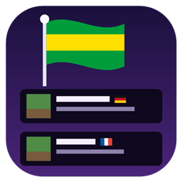

<p align="center"></p>

# Server Flags (Horizon mod)

A small flag beside each server in your Multiplayer list for the country it is hosted in. Hover the flag for the
country's name. Pick servers close to you for a better ping at a glance.

Client side only.

## What it does

- A 12 x 8 pixel-art flag after each saved server's name (or on its icon when the name is long).
- 67 countries have a drawn flag, the ones servers are most often hosted in; any other country shows its
  two-letter code, like **MT**.
- Hovering a flag shows the country, like "Germany (DE)".
- A grey **?** marks a server whose location can't be shown; hover it for why.
- Servers on your own network (LAN, 192.168.x.x, 127.0.0.1 and the like) are never looked up.

## Privacy: what is sent where

To know where a server is, the mod resolves the server's address to an IP address and sends **only that IP** to
[api.country.is](https://country.is) (open source, no account or key), which answers with a country code. It does so
once per server per game session (a lookup that couldn't get through is tried again a minute later, three times at
most), in the background, and only while **Look up server locations** is on. Nothing
about you, your account or your other servers is sent, and addresses on your own network (including IPv4 written
as IPv6, like `::ffff:192.168.1.2`) are never looked up. Turn the setting off and the mod starts no new lookups; one
that is already on its way when you switch it off may still finish.

The request is made by your system's `curl` program, which Windows 10 and 11, macOS and most Linux systems include.
It runs with `--disable`, so your own curl settings (a `.curlrc`) are not used: no extra headers are sent and no file
is written.

## Settings

Options > Mods > Server Flags > **Config**. Each button steps through its values.

| Setting | Values | Default |
|---|---|---|
| Look up server locations | OFF, ON | ON |
| Flag position | After the name, On the icon | After the name |
| Country name on hover | OFF, ON | ON |
| Code when no flag | OFF, ON | ON |
| ? when the location is unknown | OFF, ON | ON |

## No flags?

A grey **?** (hover it) and a line in the game log say why:

- **"Location lookup blocked"**: something stops the game from reaching `api.country.is`, most often an ad
  blocker's DNS list (AdGuard Home's default *AdGuard DNS filter* blocks it, Pi-hole lists often do), or a firewall.
  Allow the domain and the flags appear within a minute, no restart needed:
  - AdGuard Home: Query Log, the blocked `api.country.is` line, ⋮, **Unblock** (or add `@@||api.country.is^` to
    Filters > Custom filtering rules).
  - AdGuard apps: add `api.country.is` to the Allowlist / User rules.
  - Pi-hole: Domains, add `api.country.is` as an exact allow.
- **"Behind DDoS protection"**: the server's address belongs to a network like Cloudflare that answers from many
  countries at once (anycast), so it has no single country. Hypixel is one. Nothing to fix.
- **"The address doesn't resolve"**: the server address in your list is wrong or your DNS can't find it.
- **Every server shows "Location lookup blocked"** on a Linux without `curl`: install it (`sudo apt install curl`,
  or your distribution's package).

A blocked or unresolved lookup is tried again a minute later, three times at most.

## Good to know

- The address is resolved as written in your server list. A server that uses a DNS SRV record (a bare domain whose
  game server is elsewhere) shows the country of the domain's own address, which is usually the same.
- A server behind a proxy or DDoS protection (TCPShield and the like) shows where the proxy is.

## Install

Made for Horizon **Nightly 2026-11-21 · f037744**.
It patches the game, so it builds only on that exact Horizon build: if the launcher lists it as
**Left out**, switch your instance to that Nightly, or wait for the version made for yours.

From GitHub:

1. Download `server_flags-2.0.4.hmod` from the [latest release](https://github.com/selfmonoraque5/server-flags/releases/latest).
2. Put it in the `horizon-native-mods` folder of your game folder, not in `mods`. On Windows that is
   `%APPDATA%\horizon\horizon-native-mods`.
3. In the launcher, open the Mods page and click **Build** (the first build downloads the mod SDK and takes a few
   minutes). After a build the launcher can look stuck for a while as it cleans its cache: let it finish.
4. When it says **Up to date**, play.

Once it is listed in the Horizon registry: Mods, find **Server Flags**, Install.

To build a local copy: `horizon-launcher native-build <this folder> --instance <instance> --trust-native-code`.

Server Flags 2.0 is made for Horizon's mod API, so its settings start from the defaults again once: the 1.x
settings files aren't read.

## Compatibility

The mod API doesn't show a mod the server list, so besides its hooks (`register`, `setting_changed`,
`client_tick_post` for the settings) the mod patches one game function (`[[native.mixin]]` in `horizon-mod.toml`):
a HEAD on `game/interface/screen_backgrounds.rs` `draw_title_screen_with_post_hook`, where it reads the server list
and draws the flags (`src/mixins/draw.rs`). It works on the Horizon build it is made for; a later Horizon that
changes that function or the server list's layout needs an update.

## How it works

| File | What it is |
|---|---|
| `horizon-mod.toml` | The manifest: id, version, the Horizon build it is made for, and the game patch |
| `src/lib.rs` | The hooks: the settings page and its values |
| `src/flags.rs` | Settings, addresses, the lookup, the flags and country names, with their tests |
| `src/mixins/draw.rs` | The game patch: the flags on the server list |
| `assets/server_flags/lang/en_us.json` | The settings page's text |

```sh
cargo test    # addresses, lookups, flags and settings
```

## Credits

Inspired by [Server Country Flags](https://modrinth.com/mod/server-country-flags) by Khajiitos. Server Flags is written
from scratch for Horizon and contains none of its code or images (the flags are drawn in code); it is not made or
endorsed by Khajiitos. Locations by [country.is](https://country.is).

## License

MIT, see [LICENSE](LICENSE).
